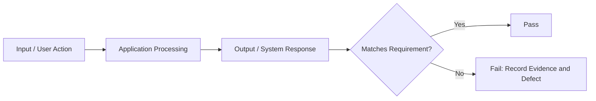
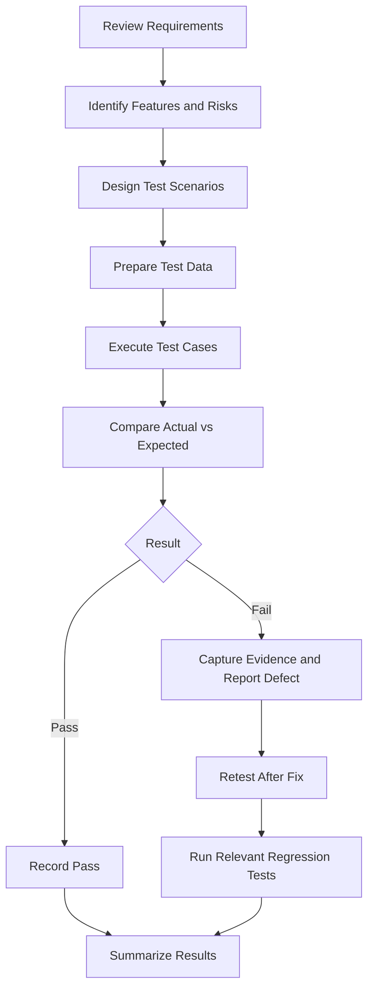
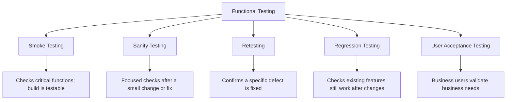
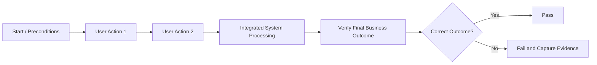
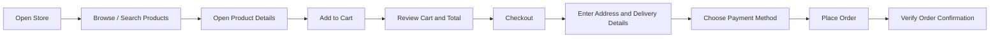
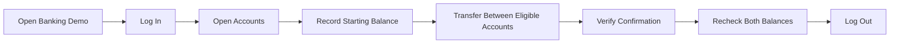
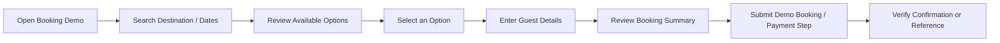
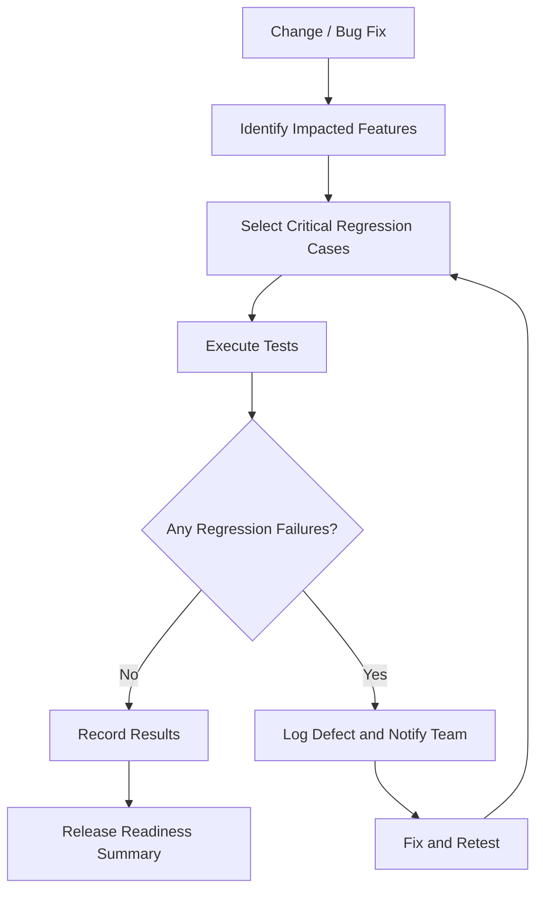
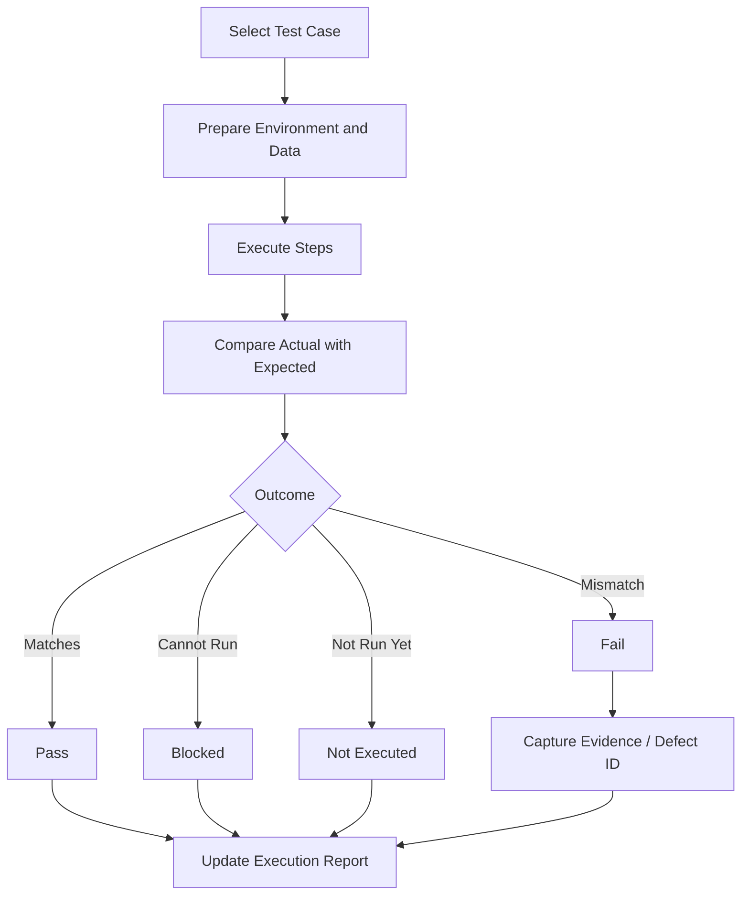
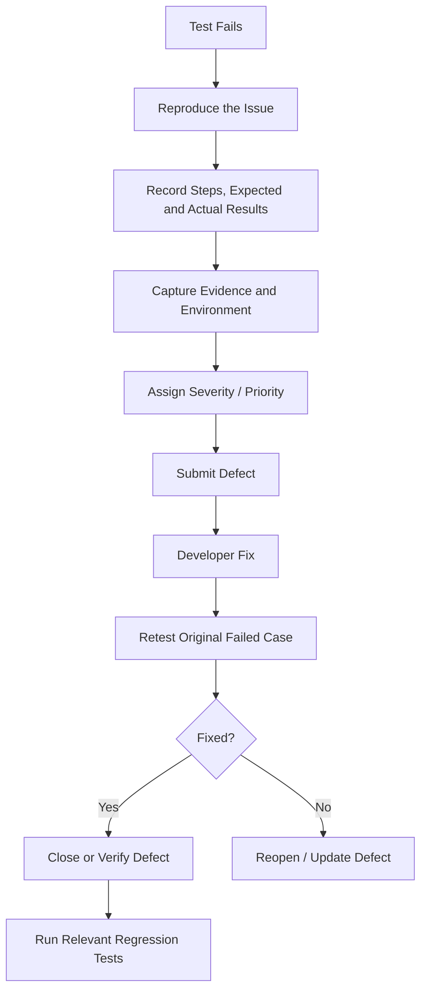

# Day 6: Functional Testing & End-to-End Testing

## 1. Project Overview

This repository documents a manual functional-testing approach for validating individual features and complete user workflows across e-commerce, banking, and booking demo applications.

**Objective:** Verify that application features behave according to their functional requirements, that connected features work together, and that critical existing functionality continues to work after changes.

**Practice applications**
- **E-commerce:** Automation Exercise — https://automationexercise.com/
- **Banking:** ParaBank — https://parabank.parasoft.com/
- **Booking:** Use the booking demo URL selected for this practice. Record the exact URL in the test execution sheet before testing.

> **Execution integrity:** Test cases and expected results in this repository are practice documentation. Mark results as Pass or Fail only after executing the case. Any explicitly simulated data must not be reported as a real application result.

## 2. Functional Testing Approach

Functional testing checks **what the system does** against specified functional requirements. Testing is performed feature by feature and through end-to-end workflows.

### Input → Process → Output



For each test, define:
1. Requirement or feature under test.
2. Preconditions and test data.
3. Steps to execute.
4. Expected result.
5. Actual result and evidence.
6. Status: Pass, Fail, Blocked, or Not Executed.

### Functional Testing Workflow



## 3. Types of Functional Testing



| Type | Purpose | Typical timing |
|---|---|---|
| Smoke testing | Check that critical features work and the build is testable | After a new build or deployment |
| Sanity testing | Quickly validate a specific area after a small change or fix | After a targeted change |
| Retesting | Execute the previously failed test to verify a defect fix | After a defect fix is available |
| Regression testing | Check that changes have not broken existing features | After code changes, fixes, or releases |
| User Acceptance Testing (UAT) | Validate the system against business needs from the end-user perspective | Before business acceptance or release |

**Important distinction:** Retesting checks the specific fixed defect. Regression testing checks related and existing functionality for unintended side effects.

## 4. End-to-End (E2E) Testing

E2E testing validates a complete real-world workflow across the connected features involved in that workflow.

### E2E test design



An E2E scenario should include:
- **Happy path:** expected actions succeed.
- **Negative path:** invalid input or a rejected action is handled correctly.
- **Alternative path:** the user completes the goal through another valid route.
- **Edge case:** boundary values, empty values, repeated actions, or unusual conditions.

### E-commerce workflow



**Validation points:** product details, cart contents, quantities, price and total calculations, required checkout fields, order submission, and confirmation details. Use only test payment methods provided by the demo application.

### Banking workflow



**Validation points:** authentication, eligible source and destination accounts, amount validation, transfer confirmation, balance changes, transaction history where available, and logout. Use demo accounts and non-real funds only.

### Booking workflow



**Validation points:** search criteria, availability, selection details, required guest fields, date and price summary, validation messages, and confirmation. If the demo does not support payment or final confirmation, record that limitation instead of assuming success.

## 5. Features to Test

| Feature | Example functional checks |
|---|---|
| Login / Logout | Valid and invalid credentials, required fields, error feedback, session termination |
| Search | Matching results, no-results state, query handling, clearing search |
| Forms (Create / Edit / Delete) | Required fields, valid data, invalid data, saved changes, deletion confirmation |
| Filters and sorting | Correct subset, selected filter state, ascending/descending order |
| Pagination | Next/previous page, first/last page, page contents, retained filters if required |
| File upload | Allowed type and size, invalid file handling, success/error feedback |
| File download | Correct file, usable file name and content, successful download |
| Print | Print preview and relevant content, where supported |
| Export data | Correct exported rows, columns, format, and data values, where supported |

Only test features that exist in the selected application. Mark unsupported features as **Not Applicable** and explain why.

## 6. Test Scenario Coverage

Create at least **10 E2E scenarios per application**: e-commerce, banking, and booking, giving **30 or more scenarios total**.

Recommended coverage:

| Scenario category | What to include |
|---|---|
| Happy path | Complete a valid workflow successfully |
| Negative | Invalid credentials, missing fields, invalid amounts or dates |
| Alternative | Different valid search, item, account, or booking choice |
| Edge case | Empty input, boundary quantity/amount, duplicate submission, unavailable result |
| Data integrity | Verify saved values, totals, balances, or booking details |
| Session | Logout, expired/invalid session behavior where testable |

For every scenario, capture **Test Case ID, Title, Preconditions, Test Data, Steps, Expected Result, Actual Result, Status, Evidence, and Notes**.

## 7. Regression Test Suite

Regression testing focuses on high-risk and frequently used features. Keep a quick-execution set for critical workflows.



Prioritize:
1. Login and logout.
2. Search and product/option selection.
3. Cart, checkout, or core transaction flow.
4. Form validation and data persistence.
5. Totals, balances, and confirmation details.
6. Previously defect-prone areas.

A regression case should have a stable ID, priority, expected result, and clear execution steps. Select the scope based on the change's impact; do not assume every release requires every test to run manually.

## 8. Test Execution and Reporting

### Execution status lifecycle



Use these statuses consistently:
- **Pass:** actual result meets expected result.
- **Fail:** actual result differs from expected result.
- **Blocked:** execution cannot continue because of an environment, dependency, or access issue.
- **Not Executed:** the case has not been run.
- **Not Applicable:** the feature or condition does not apply; include a reason.

Execution summary metrics:
- Total cases
- Passed, failed, blocked, not executed, and not applicable
- Pass rate = Passed ÷ (Passed + Failed) × 100, if at least one case has a Pass/Fail result
- Defect IDs and evidence links for failures

Do not count Blocked or Not Executed cases as Pass. A pass rate alone is not proof of release readiness; review failures, coverage, and risk.

## 9. Defect Reporting and Retesting

Bug reports are supporting practice documentation for this project, not a separate mandatory Day 6 deliverable.



A useful defect report contains:
- Unique Bug ID and concise title
- Environment, browser, and build/version
- Preconditions and test data
- Numbered Steps to Reproduce
- Expected and actual result
- Severity and priority
- Reproducibility and reproduction attempts/rate
- Evidence or attachment link
- Related test case ID and current status

Only claim that a defect is reproducible after attempting to reproduce it. Use real evidence for real defects; simulated examples must be labelled as simulated.

## 10. Test Environment and Data Setup

Record the following in the execution tracker before testing:
- Application name and exact URL
- Date/time of execution
- Operating system and browser/version
- Build/version if provided
- Tester
- Account type and test data source (never record real passwords)
- Network, access, or environment issues
- Any demo-application limitations

Use authorized demo accounts and synthetic data. Do not use real banking credentials, real payment information, or sensitive personal data.

## 11. How to Execute the Documentation

1. Open the relevant test case sheet: Smoke, Sanity, E2E, or Regression.
2. Confirm the application URL and test environment.
3. Prepare the stated preconditions and test data.
4. Execute each step in order.
5. Compare the observed result with the expected result.
6. Enter the actual result and status.
7. For failures, record reproduction steps, evidence, and a defect reference.
8. Retest fixes and run relevant regression cases.
9. Update the execution summary and README with actual outcomes.

This is a **manual testing** exercise. No automated test command is required unless automation is added separately.

## 12. Repository Structure

```text
Day-6-Functional-E2E-Testing/
├── README.md
├── Smoke-Testing/
│   ├── Smoke-Test-Checklist.md
│   └── Smoke-Test-Scenarios.xlsx
├── Sanity-Testing/
│   ├── Sanity-Test-Cases.md
│   └── Sanity-Test-Cases.xlsx
├── E2E-Testing/
│   ├── E-commerce/
│   ├── Banking/
│   └── Booking/
├── Regression-Testing/
│   └── Regression-Test-Suite.xlsx
└── Test-Execution/
    └── Full-Test-Execution-Report.xlsx
```

Keep the bug-report set optional unless your trainer or project reviewer requests it. Update these names to match the files actually committed to your repository.

## 13. Day 6 Deliverables Checklist

- [ ] Smoke test checklist
- [ ] Sanity test cases
- [ ] At least 30 E2E scenarios (10 per application)
- [ ] Regression test suite
- [ ] Test execution results
- [ ] This README documenting the functional testing approach

## 14. Limitations and Accuracy

- The existence of a test case does not mean it has been executed.
- Mark results only after observing the application.
- Label simulated practice results clearly; do not present them as real test evidence.
- Demo websites can change, be unavailable, or lack some production features.
- Record unsupported features and access limitations in the execution report.

## 15. Summary

The approach starts with critical smoke checks, validates targeted changes through sanity testing and retesting, covers full business workflows with E2E scenarios, and uses regression testing to check for unintended side effects. Test execution results must be evidence-based and traceable to individual test cases.
