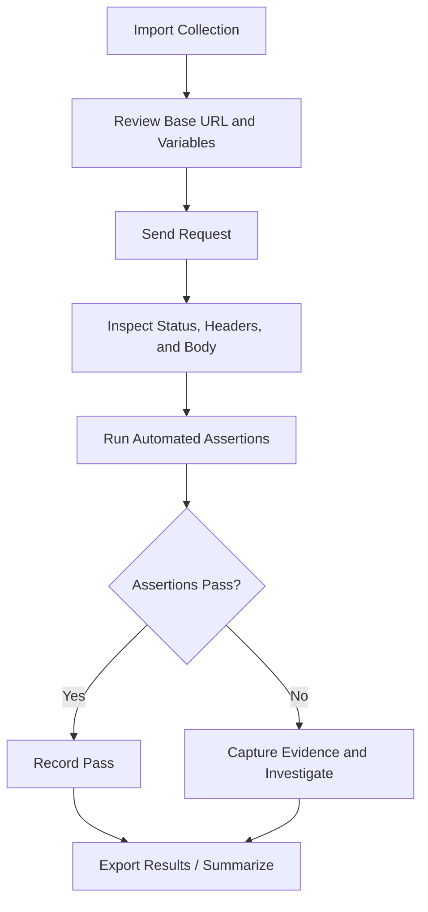

# API Testing Approach — Day 7

## 1. Purpose
This practice plan uses Postman to validate API integration behavior: HTTP methods, status codes, JSON response structure, query filtering, and basic negative scenarios.

## 2. Practice API
- **Base URL:** `https://jsonplaceholder.typicode.com`
- **Service:** JSONPlaceholder public demo REST API.
- **Important limitation:** POST, PUT, PATCH, and DELETE responses are simulated by this service. Do not treat them as persistent database changes.
- Use this collection for learning and portfolio practice only. Check the service's current documentation and availability before execution.

## 3. HTTP Methods
| Method | Common purpose | Practice request |
|---|---|---|
| GET | Read resources | List posts, get one post, list users |
| POST | Create a resource | Create a post; demo response only |
| PUT | Replace/update a resource | Update post; demo response only |
| PATCH | Partially update a resource | Patch post title; demo response only |
| DELETE | Delete a resource | Delete post; demo response only |

## 4. Common Status Codes
| Code | Meaning | Typical validation |
|---|---|---|
| 200 | OK | Successful read/update response |
| 201 | Created | Resource creation response |
| 204 | No Content | Successful operation with no response body, if contract specifies |
| 400 | Bad Request | Invalid request data |
| 401 | Unauthorized | Authentication missing or invalid |
| 403 | Forbidden | Authenticated user lacks permission |
| 404 | Not Found | Resource does not exist |
| 409 | Conflict | Request conflicts with current resource state |
| 500 | Internal Server Error | Server-side failure |

The correct status code depends on the API contract. This public demo may not implement all negative responses in the same way as a production API.

## 5. Postman Workflow

## 6. Requests Included
1. GET all posts
2. GET post by ID
3. GET posts by user ID
4. POST create post (simulated)
5. PUT update post (simulated)
6. PATCH post title (simulated)
7. DELETE post (simulated)
8. GET non-existent post
9. GET comments for a post
10. GET users
11. GET albums for a user

## 7. Assertions to Practice
- Verify expected status code.
- Verify response is valid JSON and has the expected type.
- Validate required fields and data types.
- Compare response IDs and fields against variables or submitted data.
- Validate filtering and relationships.
- For negative tests, assert the behavior documented by the specific API contract; do not assume all APIs return identical error bodies.

## 8. How to Import and Run
1. Open Postman.
2. Select **Import** and choose `Postman-Collection.json`.
3. Open the imported collection and check the `baseUrl`, `postId`, and `userId` variables.
4. Send requests individually first.
5. Inspect response status, body, headers, and the **Test Results** tab.
6. Run the collection with Collection Runner when ready.
7. Record actual results in `API-Test-Results.xlsx`; leave tests Not Executed until you run them.

## 9. Reporting Rules
Record request name, method, endpoint, expected and actual status, assertion result, execution date, environment, evidence, and notes. Do not claim a request passed until it has actually been sent and inspected. Never put tokens, passwords, or sensitive data into the collection or Git history.

## 10. Deliverables
- `API-Testing-Approach.md`
- `API-Testing-Approach-Google-Docs.docx`
- `Postman-Collection.json`
- `API-Test-Results.xlsx`

**Practice note:** The collection is a learning example against a public demo API. It is not evidence of testing your actual application until you execute it and record the results.
