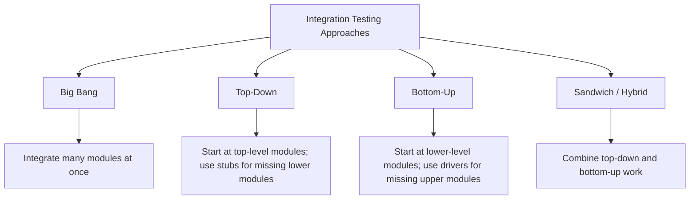
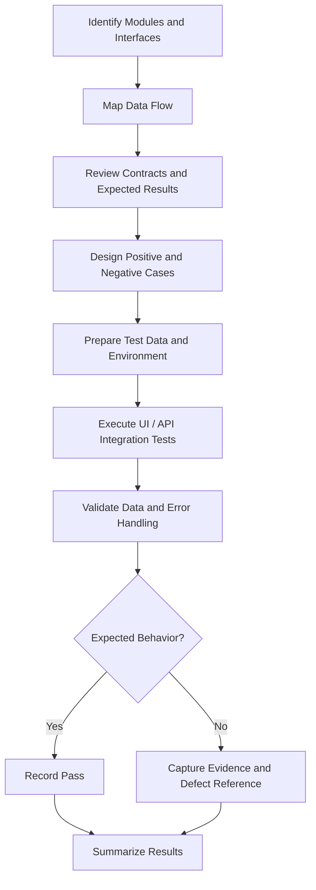

# Integration Test Strategy

## 1. Document Information

| Field | Details |
|---|---|
| Project | Day 7 — System and Integration Testing |
| Document | Integration Test Strategy |
| Testing level | Integration testing |
| Approach | Primarily manual, with Postman for API checks |
| Status | Planning document — update after execution |
| Version | 1.0 |

## 2. Purpose

This strategy describes how to test communication and data exchange between connected application modules, APIs, services, and databases. The objective is to detect interface defects before they appear in complete system workflows.

## 3. Objectives

- Verify that connected modules exchange the correct data.
- Validate API requests, responses, status codes, headers, and JSON fields.
- Check that data created or updated in one module is reflected correctly in dependent modules.
- Validate error handling when a dependency is unavailable or returns an error.
- Confirm authentication and authorization information is handled correctly.
- Check data integrity across module boundaries.
- Produce repeatable test cases with traceable results.

## 4. Integration Points

| Integration point | Example | What to validate |
|---|---|---|
| UI → API | Login form submits credentials | Request fields, response, validation message |
| API → API | Search service calls inventory service | Identifiers, response mapping, error propagation |
| API → Database | Create/update request persists data | Saved values and data consistency, using authorized access |
| Cart → Checkout | Cart contents passed to checkout | Items, quantities, prices, totals |
| Payment step → Order | Approved demo payment creates order | Correct status and order association; use demo-only flow |
| Banking transfer → Account balances | Transfer updates source and destination accounts | Correct amount, balances, and transaction history |
| Booking search → Confirmation | Selected option and guest details carry through | Dates, option, guest details, confirmation reference |

Only test integrations supported by the selected demo application. Do not assume an internal API or database is accessible if it is not exposed.

## 5. Integration Testing Approaches

| Approach | Description | Advantages | Risks / limitations |
|---|---|---|---|
| Big Bang | Combine all or many modules, then test the integrated system | Simple to start when all modules are ready | Fault isolation is difficult; integration defects may be found late |
| Top-Down | Test higher-level modules first, adding lower-level modules gradually | Early validation of main flows | Missing lower modules may need stubs |
| Bottom-Up | Test lower-level modules first, adding higher-level modules gradually | Early validation of utilities and services | End-user flows may be tested later; drivers may be needed |
| Sandwich / Hybrid | Combine top-down and bottom-up approaches | Supports parallel work and layered systems | Coordination and interface agreements are important |

A manual tester using a public demo website often validates observable module interactions rather than implementing stubs or drivers. Record which approach is actually applicable to the project.

## 6. Strategy and Workflow

1. Identify the modules and interfaces involved in each business workflow.
2. Map request fields, response fields, identifiers, and data ownership.
3. Define expected behavior for valid, invalid, missing, and boundary inputs.
4. Prepare synthetic data and confirm the test environment.
5. Execute interface and data-flow checks.
6. Verify error handling and recovery behavior.
7. Record observed results and evidence.
8. Retest fixes and run related regression tests.

## 7. Test Design Coverage

- **Positive flow:** valid data crosses the interface and is processed correctly.
- **Negative flow:** invalid or missing data is rejected with appropriate feedback.
- **Data mapping:** source fields map to the correct target fields.
- **State consistency:** updates in one module are reflected in dependent views.
- **Error propagation:** a downstream error is handled safely and clearly.
- **Authentication:** protected endpoints require valid authorization where applicable.
- **Duplicate/retry behavior:** repeated submission does not create unintended duplicate records, where the application supports checking this.
- **Boundary conditions:** minimum, maximum, empty, and unusually long values are handled according to requirements.

## 8. API Integration Checks

For each API request, capture:

- HTTP method and endpoint.
- Required headers and authentication method, if applicable.
- Request body and data types.
- Expected status code.
- Response body fields and data types.
- Response time observation, if recorded, without claiming a performance benchmark.
- Error response behavior for invalid input.
- Relationship between the API result and the downstream UI or data state.

Common HTTP status codes include 200 OK, 201 Created, 204 No Content, 400 Bad Request, 401 Unauthorized, 403 Forbidden, 404 Not Found, 409 Conflict, and 500 Internal Server Error. The correct status depends on the API contract; do not expect every API to use all codes.

## 9. Test Environment and Data

- Use only authorized public demo applications and documented endpoints.
- Record exact base URL, environment, browser, and execution date.
- Use synthetic user data and demo accounts.
- Do not use real credentials, payment details, or sensitive personal information.
- Do not send destructive requests to production systems.
- If a database is not accessible, validate persisted state through the supported UI or API instead of assuming direct database access.

## 10. Entry Criteria

- Modules, interfaces, or observable integration points are identified.
- Test environment and required access are available.
- Expected behavior or API contract is known.
- Test data is prepared and safe to use.
- Dependencies are available or their limitations are documented.

## 11. Exit Criteria

- Planned integration cases have recorded statuses or a reason for not executing.
- Critical data flows have been checked.
- Failures include evidence and reproducible steps where possible.
- Open integration risks and blocked dependencies are documented.
- Relevant fixes have been retested.
- Results and limitations are summarized.

## 12. Defect Reporting

For a failure, record the related test case ID, interface or module pair, request/response details with secrets removed, preconditions, numbered reproduction steps, expected result, actual result, environment, severity, and evidence. Never place passwords, tokens, or sensitive personal data in reports or screenshots.

## 13. Reporting and Metrics

Track:
- Total planned, executed, passed, failed, blocked, and not-executed cases.
- Integration points covered.
- Failures by module/interface and severity.
- Open defects and retest status.
- Known limitations and residual risk.

Pass rate, if reported, is Passed ÷ (Passed + Failed) × 100. Do not count Blocked or Not Executed as Pass. A metric does not replace analysis of risk or coverage.

## 14. Deliverables

- Integration Test Strategy (this document).
- Integration test cases covering module interactions and data flow.
- Postman collection and API execution results, where applicable.
- Defect evidence and references for observed failures.
- Summary of coverage, blocked items, and residual risks.

## 15. Execution Status

- **Pass:** observed behavior meets expected behavior.
- **Fail:** observed behavior differs from expected behavior.
- **Blocked:** an environment, access, or dependency issue prevents execution.
- **Not Executed:** the case has not been run.
- **Not Applicable:** the interface or feature does not exist in the selected application; include a reason.

Clearly label simulated practice results. Record actual outcomes only after executing the cases.

## 16. Revision History

| Version | Date | Change |
|---|---|---|
| 1.0 | 13-Oct-2026 | Initial integration test strategy |
