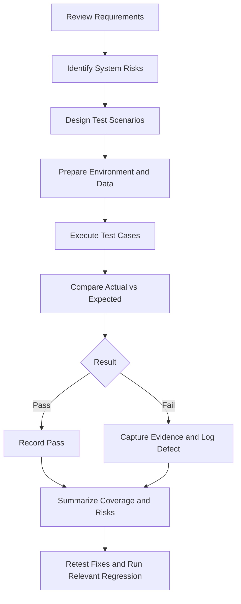

# System Test Plan

## Day 7 — System and Integration Testing

# 1. Document Information

| Field | Details |
|---|---|
| Project | Day 7 — System and Integration Testing |
| Document | System Test Plan |
| Testing level | System testing |
| Approach | Primarily manual, using authorized demo environments |
| Status | Planning document — update after execution |
| Version | 1.0 |

# 2. Purpose

This plan defines how the complete application will be validated against system requirements in a production-like test environment. It covers scope, approach, environment, test data, entry and exit criteria, risks, and reporting.

System testing evaluates the application as a whole. Integration testing focuses on interactions between modules and services and is documented separately.

# 3. Objectives

- Verify end-to-end behavior against functional requirements.
- Validate non-functional characteristics where suitable tools and environments permit.
- Confirm important user journeys across connected modules.
- Check error handling, input validation, data integrity, and recovery behavior.
- Record outcomes and defects with reproducible evidence.
- Summarize coverage, failures, limitations, and remaining risks.

# 4. Scope

**In scope**
- Authentication and session behavior, where available.
- Core user workflows and business rules.
- Forms, validation, and saved data.
- Search, filters, sorting, and pagination, where supported.
- Checkout or transaction workflows in demo applications.
- Error messages and negative scenarios.
- Browser and screen-size compatibility checks in the available environment.
- Basic usability observations and manual accessibility checks.
- Performance observations only with suitable tools, permission, and a baseline.

**Out of scope**
- Production systems, real customer accounts, real money, or real payment details.
- Penetration, destructive security, or load testing without explicit authorization.
- Features not present in the selected application.
- Claims about performance or security without suitable testing and evidence.

# 5. Test Items and Candidate Applications

| Application | Candidate areas | Test data |
|---|---|---|
| Automation Exercise | Account, products, cart, checkout, order workflow | Synthetic account and demo data |
| ParaBank | Login, accounts, transfers, transaction history | Demo accounts and non-real funds only |
| Booking demo | Search, selection, guest details, confirmation | Synthetic guest details; no real payment data |

Record the exact URL, date, browser, and build/version before testing. Confirm each demo supports the planned feature. Mark unsupported features Not Applicable and explain why.

# 6. Test Approach

1. Review available requirements and application behavior.
2. Prioritize critical user journeys and high-risk features.
3. Prepare reusable test data and confirm the environment.
4. Execute positive, negative, alternative, and boundary scenarios.
5. Compare actual behavior with expected results.
6. Record Pass, Fail, Blocked, Not Executed, or Not Applicable.
7. Capture evidence and a defect reference for failures.
8. Retest verified fixes and run relevant regression cases.
9. Summarize coverage, defects, limitations, and remaining risks.

# 7. System Testing Types

| Type | Purpose | Example |
|---|---|---|
| Functional system testing | Verify complete system behavior | Complete a demo-store purchase workflow |
| Performance testing | Evaluate response time, throughput, or stability under defined load | Only with authorized tools, baseline, and environment |
| Security testing | Check approved security requirements and safeguards | Validate access restrictions without unauthorized exploitation |
| Usability testing | Assess clarity and ease of completing a task | Check form labels, messages, and navigation |
| Compatibility testing | Check supported browsers, devices, or screen sizes | Repeat a critical workflow in supported browsers |

Do not claim performance or security coverage if those tests were not executed.

# 8. Test Environment

Record before execution:
- Application name and exact URL.
- Operating system and browser name/version.
- Build/version, if exposed.
- Date/time and tester.
- Network/access constraints.
- Account type and test data source; never store real passwords.
- Browser settings or extensions that could affect results.
- Known demo limitations.

Use an authorized demo environment and synthetic data. Never use real banking credentials, real payment details, or sensitive personal information.

# 9. Test Data Strategy

- Use valid synthetic data for successful workflows.
- Use invalid, missing, malformed, and boundary values for negative testing.
- Keep data consistent across related cases when checking state changes.
- Avoid real people's personal information.
- Do not include secrets or passwords in screenshots, reports, or Git history.
- Record dependencies that affect repeatability.

# 10. Entry Criteria

- Test environment is accessible and sufficiently stable.
- Scope and test cases have been reviewed.
- Demo accounts and synthetic data are available.
- Expected results can be identified from requirements or documented behavior.
- Tester has permission to perform planned actions.

# 11. Exit Criteria

- All planned in-scope cases have a recorded status or an explicit reason for not running.
- Critical workflows have been executed or marked Blocked.
- Failures have evidence and traceable defect references where applicable.
- High-severity open defects and untested risks are documented.
- Available fixes have been retested.
- Final report summarizes results, limitations, and residual risks.

Meeting exit criteria does not automatically mean the application is defect-free or approved for release.

# 12. Severity and Priority Guidance

| Level | Severity example | Priority guidance |
|---|---|---|
| Critical | Core system unusable or major data integrity issue | Immediate investigation |
| High | Major business workflow fails with no reasonable workaround | Fix urgently |
| Medium | Feature impaired but workaround exists | Schedule based on impact |
| Low | Minor visual or low-impact behavior issue | Fix when appropriate |

Severity describes impact; priority describes urgency. Assign values based on evidence and team conventions.

# 13. Roles and Responsibilities

| Role | Responsibility |
|---|---|
| QA tester | Prepare and execute cases, record results, capture evidence |
| Developer / technical owner | Investigate defects and provide fixes |
| Test lead / reviewer | Review scope, risks, coverage, and reporting |
| Business reviewer | Confirm business expectations where acceptance criteria are needed |

For an individual practice project, one person may perform multiple roles. Identify assumptions rather than inventing approvals.

# 14. Risks and Mitigations

| Risk | Mitigation |
|---|---|
| Demo site unavailable or changes | Record date/time, retry later, mark Blocked if execution cannot proceed |
| Requirements incomplete | Record assumptions and clarify expected behavior |
| Test data changes state | Define setup/cleanup steps and verify initial state |
| Third-party service unavailable | Separate environment failure from product failure and capture evidence |
| Performance/security tools unavailable | Mark out of scope or not executed; do not claim coverage |
| Simulated results mistaken for actual | Label simulated data and replace it with observed results |

# 15. Deliverables

- System Test Plan.
- System test cases or scenario list.
- Test execution results with actual outcomes.
- Defect references and evidence, where defects are observed.
- Summary of coverage, limitations, and remaining risks.

# 16. Execution Status Definitions

- **Pass:** Observed behavior meets the expected result.
- **Fail:** Observed behavior differs from the expected result.
- **Blocked:** Execution cannot proceed because of an environment, dependency, or access issue.
- **Not Executed:** The test has not been run.
- **Not Applicable:** The feature or condition does not apply; include a reason.

Use only observed results for actual reporting. Simulated examples are practice data and must be labelled as simulated.

# 17. Approval and Revision History

| Version | Date | Change |
|---|---|---|
| 1.0 | 13-Oct-2026 | Initial system test plan for Day 7 practice |

# 18. Final Checklist

- [ ] Confirm application URLs and environment details.
- [ ] Review planned scope and risks.
- [ ] Prepare synthetic test data.
- [ ] Execute and record planned system tests.
- [ ] Attach evidence for failures.
- [ ] Retest fixes and execute relevant regression cases.
- [ ] Complete the execution report and document unresolved risks.