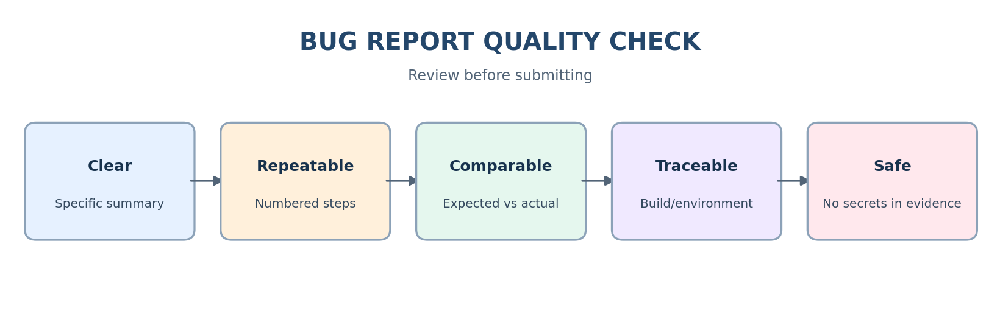

# Bug Reporting Best Practices

## Before reporting
- Reproduce the issue when possible.
- Check for duplicates and compare behavior with requirements.
- Record environment, build, and non-sensitive test data.

## While writing
- Use a concise, descriptive summary.
- Number steps in the exact order performed.
- Separate expected and actual results.
- State frequency only when observed.
- Attach useful evidence.
- Report one defect per ticket.
- Describe evidence, not assumptions about root cause.
- Use neutral, professional language.

## Severity and priority
- Rate severity by impact and scope.
- Recommend priority with a brief business rationale.
- Follow team definitions; triage confirms or adjusts priority.

## Evidence and privacy
- Redact passwords, tokens, session cookies, personal information, and secrets.
- Capture enough context to reproduce the issue.
- Avoid unrelated screenshots and huge unfiltered logs.
- Use approved storage for attachments.

## Review checklist
- [ ] Clear summary and preconditions
- [ ] Numbered reproduction steps
- [ ] Expected and actual results
- [ ] Environment/build
- [ ] Severity and priority rationale
- [ ] Useful evidence, no sensitive data
- [ ] One defect, no duplicate, neutral wording

**Practice integrity:** Sample reports are illustrative. Mark a report as reproduced only after observing the behavior in the stated environment.
