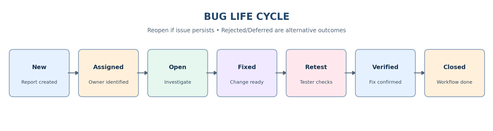

# Bug Life Cycle Notes

## Purpose
Track a defect from initial report through investigation, fix validation, and closure. Status names and allowed transitions vary by organization and tracking tool.

## Status definitions
| Status | Meaning |
|---|---|
| New | Newly reported issue awaiting triage. |
| Assigned | An owner has been identified. |
| Open | Accepted for investigation or work. |
| Fixed | Developer reports the fix is ready. |
| Retest | Tester validates the fix in a suitable build/environment. |
| Verified | Tester confirms the reported behavior is corrected. |
| Closed | Workflow is complete. |
| Reopen | Issue persists or fix is incomplete; investigate again. |
| Rejected | Not accepted as a valid defect; record the reason. |
| Deferred | Accepted but planned for a later release; record rationale. |

## Typical transition
New → Assigned → Open → Fixed → Retest → Verified → Closed

If the issue persists during retest, reopen it with fresh evidence. “Fixed” does not mean “Verified.”

## Practical example
A tester reports that valid credentials produce an error. The report starts as New. After triage it is Assigned and Open. A developer marks it Fixed. The tester retests in the target build. If the dashboard opens correctly, the issue can be Verified and Closed. If the error remains, Reopen the report and add the observed result and evidence.

## QA checklist
- Confirm expected behavior before reporting.
- Preserve the environment/build used for retesting.
- Record why an issue is rejected or deferred.
- Follow the team's workflow and transition rules.
