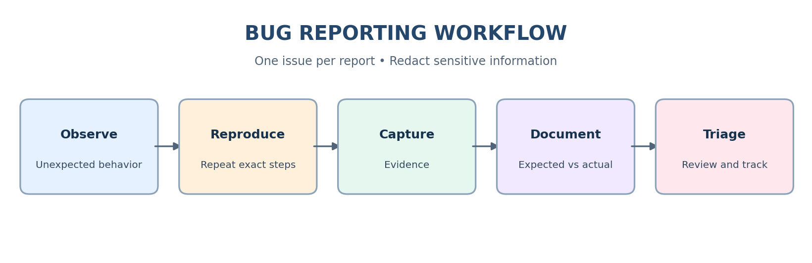
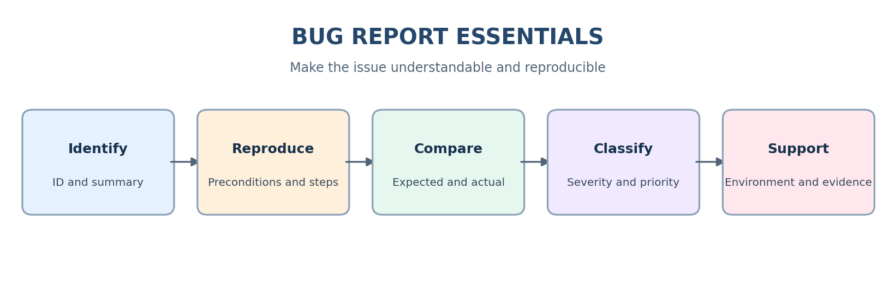

# Day 8: Bug Life Cycle & Bug Reporting

**Purpose:** Learn to track defects through a defined life cycle, write reproducible bug reports, classify severity and priority, and communicate issues clearly.


## Learning Objectives
- Understand common bug life-cycle states and transitions.
- Write clear, reproducible defect reports.
- Classify issues using severity and priority.
- Communicate defects objectively with supporting evidence.

## 1. Project Overview
Day 8 focuses on defect workflow and communication. A good bug report records what happened, how to reproduce it, what should have happened, what actually happened, and enough environment/evidence details for another person to investigate.

**Execution integrity:** The reports included in this project are illustrative practice examples. They are not proof that the described issues were reproduced in a live application.

## 2. Bug Life Cycle
A bug life cycle tracks a suspected defect from the first report through investigation, fix validation, and closure. Status names and allowed transitions vary by team and tracking tool.


| Status | Meaning |
|---|---|
| New | A suspected defect has been reported and is awaiting triage. |
| Assigned | An owner has been identified. |
| Open | The defect is accepted for investigation or work. |
| Fixed | The developer reports that a fix is ready for testing. |
| Retest | The tester checks the fix in a suitable build/environment. |
| Verified | The tester confirms the reported behavior is corrected. |
| Closed | The agreed defect workflow is complete. |
| Reopen | The issue still exists or the fix is incomplete; further investigation is needed. |
| Rejected | The report is not accepted as a valid defect, for example, expected behavior or duplicate. Record the reason. |
| Deferred | The team accepts the issue but schedules it for a future release. Record rationale and target when known. |

**Typical path:** New → Assigned → Open → Fixed → Retest → Verified → Closed.  
If the defect persists during retest, reopen it and attach fresh evidence. “Fixed” does not mean “Verified.”

## 3. Effective Bug Reporting Workflow


1. Observe unexpected behavior.
2. Reproduce it with repeatable steps, when possible.
3. Capture relevant evidence such as a screenshot, video, log, or API response.
4. Write expected and actual results separately.
5. Record environment, severity, priority recommendation, and impact.
6. Submit the report and track it through triage and resolution.

## 4. Bug Report Components


| Component | What to include |
|---|---|
| Bug ID | Unique ID from the tracker or report sheet. |
| Summary | Concise line naming the area/action and failure. |
| Description / Impact | Context and affected function/users. |
| Preconditions | Required account state, setup, flags, or data. |
| Steps to Reproduce | Numbered actions in the exact order performed. |
| Expected Result | Intended behavior based on requirements. |
| Actual Result | Observed behavior and exact error text where useful. |
| Severity | Impact of the defect, using team definitions. |
| Priority | Recommended urgency; confirm during triage. |
| Environment | App/build, OS, browser/device, versions and relevant configuration. |
| Attachments | Evidence that helps reproduce or understand the issue. |
| Reporter / Date / Status | Traceability and workflow tracking. |

## 5. Severity vs Priority
Severity describes **how much impact** a defect causes. Priority describes **how soon it should be addressed**. They are related but not interchangeable. Product, QA, and engineering stakeholders may confirm priority during triage.


### Illustrative severity levels
- **Critical:** system crash, data loss/corruption, or core business flow completely blocked.
- **Major:** important functionality unavailable or incorrect, with significant impact.
- **Minor:** limited functional issue; workaround may exist.
- **Trivial:** cosmetic issue or typo with negligible functional impact.

### Illustrative priority levels
- **P1 / High:** immediate attention because of urgent business or release risk.
- **P2 / Medium:** address in the current release or iteration.
- **P3 / Low:** schedule when capacity permits.


| Scenario | Suggested severity | Suggested priority | Reason |
|---|---|---|---|
| Checkout crashes for all customers | Critical | P1 / High | Core purchase flow is blocked. |
| Password reset fails for all users | Major | P1 / High | Account recovery is blocked. |
| Incorrect legal/compliance notice | Major or Critical | P1 / High | Compliance risk can make it urgent. |
| Common search query returns incorrect results | Major | P2 / Medium | Important feature is impaired; assess workaround. |
| Rare optional report export fails | Minor or Major | P2 or P3 | Depends on business importance and workaround. |
| Misaligned icon on a secondary page | Minor | P3 / Low | Cosmetic issue with low functional impact. |
| Typo on an internal low-traffic page | Trivial | P3 / Low | Low impact and urgency. |

These are examples, not universal mappings. Use the team's agreed definitions and document the rationale.

## 6. Write Effective Bug Reports
- Use a specific summary, not “Not working.”
- Include preconditions and numbered steps that another person can follow.
- Separate expected and actual behavior.
- Include exact error messages when relevant.
- Record environment, application build, and versions.
- Attach evidence that demonstrates the issue.
- Report one defect per ticket unless the team has a documented reason to group related symptoms.
- Use neutral language and describe observations, not assumptions about root cause.
- Check for duplicates.
- Redact passwords, access tokens, session cookies, personal information, and secrets.


## 7. Common Mistakes to Avoid
- Vague summaries or ambiguous descriptions.
- Missing or unordered reproduction steps.
- Missing expected result or actual result.
- Missing environment/build details.
- Screenshots that do not show the relevant state.
- Combining unrelated defects in one ticket.
- Exposing sensitive data in attachments.
- Assigning severity/priority without applying the team's definitions.
- Blaming language or unsupported assumptions.

## 8. Practice Assignment
1. Review a demo application and identify candidate defects.
2. Create 20 bug reports using the standardized template.
3. Add suggested severity and priority with a brief rationale.
4. Include preconditions, reproducible steps, expected/actual results, and environment.
5. Capture evidence only for issues you actually reproduce.
6. Review all reports for clarity, duplication, privacy, and completeness.

## 9. Project Files
- `Bug-Life-Cycle/Bug-Life-Cycle-Notes.md` — status definitions and transitions.
- `Bug-Life-Cycle/Bug-Life-Cycle-Notes.docx` — Word version.
- `Bug-Reporting/Bug-Report-Template.md` — reusable template.
- `Bug-Reporting/Bug-Report-Template.docx` — Word version.
- `Practice-Bug-Reports/20-Sample-Bug-Reports.md` and `.xlsx` — illustrative practice examples.
- `Severity-Priority/Severity-vs-Priority-Guide.md` and `.xlsx` — guide and examples.
- `Best-Practices/Bug-Reporting-Best-Practices.md` and `.docx` — best-practice checklist.
- Diagrams are stored in the relevant topic folders, not in a separate README-only folder.

## 10. GitHub Repository Folder Structure
```text
Day-8-Bug-Life-Cycle-and-Bug-Reporting/
├── README.md
├── README.docx
├── Bug-Life-Cycle/
│   ├── Bug-Life-Cycle-Notes.md
│   ├── Bug-Life-Cycle-Notes.docx
│   └── bug-life-cycle.png
├── Bug-Reporting/
│   ├── Bug-Report-Template.md
│   ├── Bug-Report-Template.docx
│   ├── bug-reporting-workflow.png
│   └── bug-report-components.png
├── Severity-Priority/
│   ├── Severity-vs-Priority-Guide.md
│   ├── Severity-vs-Priority-Examples.xlsx
│   ├── severity-priority.png
│   └── severity-priority-examples.png
├── Practice-Bug-Reports/
│   ├── 20-Sample-Bug-Reports.md
│   └── 20-Sample-Bug-Reports.xlsx
└── Best-Practices/
    ├── Bug-Reporting-Best-Practices.md
    ├── Bug-Reporting-Best-Practices.docx
    └── report-quality-checklist.png
```

