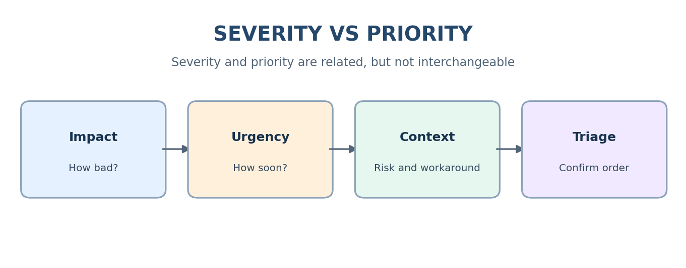
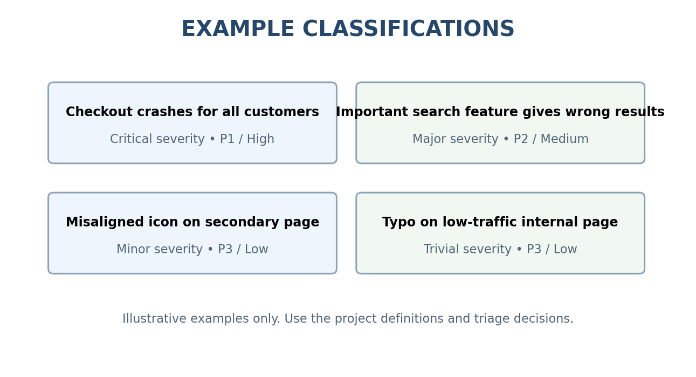

# Severity vs Priority Guide

- **Severity:** impact caused by the defect.
- **Priority:** urgency/order for fixing, considering business needs, release timing, workarounds and risk.

## Illustrative severity levels
| Level | Example meaning |
|---|---|
| Critical | System crash, data loss/corruption, or core flow blocked |
| Major | Important functionality unavailable or incorrect |
| Minor | Limited issue; workaround may exist |
| Trivial | Cosmetic issue or typo with negligible functional impact |

## Illustrative priority levels
| Level | Example meaning |
|---|---|
| P1 / High | Immediate attention due to urgent business/release risk |
| P2 / Medium | Address in current release/iteration |
| P3 / Low | Schedule when capacity permits |

| Scenario | Severity | Priority | Rationale |
|---|---|---|---|
| Checkout crashes for all customers | Critical | P1 / High | Core purchase flow blocked |
| Password reset fails for all users | Major | P1 / High | Account recovery blocked |
| Incorrect compliance notice | Major/Critical | P1 / High | Compliance risk |
| Common search results are incorrect | Major | P2 / Medium | Important feature impaired |
| Rare optional export fails | Minor/Major | P2/P3 | Depends on business use and workaround |
| Misaligned icon | Minor | P3 / Low | Cosmetic |
| Typo on low-traffic internal page | Trivial | P3 / Low | Low impact |

Do not mechanically map severity to priority. Explain the rationale and confirm priority during triage.
